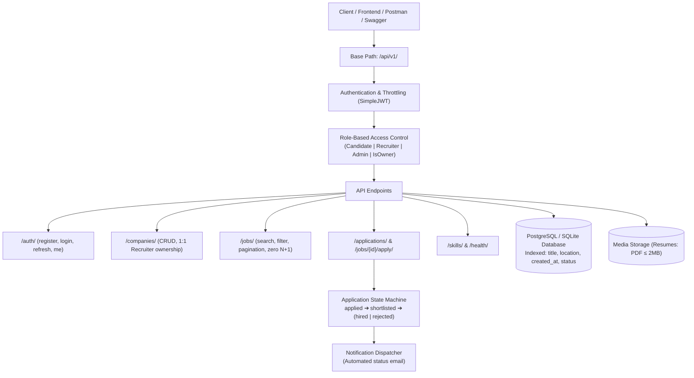

# Job Portal REST API

[](https://github.com/katlashylu-cpu/jobportal-api/actions)


A production-style, API-first backend service connecting recruiters who post job openings with candidates who discover and apply to them. Built using **Django**, **Django REST Framework (DRF)**, **SimpleJWT**, **PostgreSQL**, and documented with **drf-spectacular (OpenAPI 3.0 / Swagger UI)**.

## Live Demo

- **Swagger UI:** https://jobportal-api-2ipb.onrender.com/api/docs/
- **Health check:** https://jobportal-api-2ipb.onrender.com/api/v1/health/

Hosted on Render (Docker, free tier) with a Neon PostgreSQL database. The first request after inactivity can take 50 seconds or more while the instance wakes up.

---

## 🌟 Architecture Overview



---

## 🚀 Key Features

- **JWT Authentication & Token Lifecycle**:
  - Secure signup and login returning short-lived access tokens and long-lived refresh tokens with token rotation.
  - Role-based self-registration for `candidate` and `recruiter`. Admin accounts can only be created via CLI / Django admin.
- **Strict Role-Based Access Control (RBAC)**:
  - **Candidates**: Search jobs, apply with valid PDF resumes ($\le$ 2MB), list personal applications, and receive email notifications on status updates.
  - **Recruiters**: Manage one company profile, publish/close/edit job postings, view applicant lists for their own jobs, and advance applicant statuses.
  - **Admins**: Comprehensive moderation over users, companies, jobs, applications, and skills via the Django admin interface.
- **Finite State Machine Application Workflow**:
  - Strict transition logic: `applied` $\rightarrow$ `shortlisted` $\rightarrow$ `hired` / `rejected`.
  - Terminal states (`hired`, `rejected`) cannot be transitioned out of.
  - Prevents duplicate applications from the same candidate to the same job with HTTP **409 Conflict**.
- **High-Performance Querying (Zero N+1 Queries)**:
  - Paginated job list runs in **3 database queries** regardless of dataset size (using `select_related` and `prefetch_related`).
- **Standardized Error Envelope**:
  - Uniform error format across all HTTP status codes (400, 401, 403, 404, 409, 429).
- **Interactive Documentation**:
  - Swagger UI served at `/api/docs/` and raw OpenAPI 3.0 schema at `/api/schema/`.
- **Production DevOps**:
  - Docker containerization with non-root security.
  - `docker-compose.yml` with health-checked PostgreSQL 16.
  - GitHub Actions CI enforcing code quality (`ruff`) and test coverage ($\ge$ 70%).

---

## 🛠️ Tech Stack

| Layer | Technology |
|---|---|
| **Language** | Python 3.12 |
| **Framework** | Django 5.1, Django REST Framework 3.15 |
| **Authentication** | djangorestframework-simplejwt (JWT) |
| **Database** | PostgreSQL 16 (production/docker), SQLite (local fallback) |
| **Filtering & Docs** | django-filter, drf-spectacular (OpenAPI 3.0 & Swagger UI) |
| **Testing** | pytest, pytest-django, pytest-cov, factory_boy (95% Coverage) |
| **Code Quality** | ruff |
| **Static Files** | WhiteNoise |
| **Containerization** | Docker, docker-compose |
| **CI/CD** | GitHub Actions |

---

## 📚 API Reference (`/api/v1/`)

Interactive Swagger UI is available at: `http://localhost:8000/api/docs/`

### 1. Authentication
| Method | Endpoint | Description | Access |
|---|---|---|---|
| `POST` | `/api/v1/auth/register/` | Register candidate or recruiter | Public |
| `POST` | `/api/v1/auth/login/` | Obtain access & refresh JWT tokens | Public |
| `POST` | `/api/v1/auth/refresh/` | Refresh expired access token | Public |
| `GET` | `/api/v1/auth/me/` | Retrieve current user profile | Authenticated |

### 2. Companies
| Method | Endpoint | Description | Access |
|---|---|---|---|
| `GET` | `/api/v1/companies/` | List companies | Public |
| `POST` | `/api/v1/companies/` | Create company (1 per recruiter) | Recruiter |
| `GET` | `/api/v1/companies/{id}/` | Retrieve company details | Public |
| `PUT/PATCH/DELETE`| `/api/v1/companies/{id}/` | Update or delete company | Owning Recruiter |

### 3. Jobs
| Method | Endpoint | Description | Access |
|---|---|---|---|
| `GET` | `/api/v1/jobs/` | List jobs (search, filter, paginate) | Public |
| `POST` | `/api/v1/jobs/` | Create a job linked to company | Recruiter |
| `GET` | `/api/v1/jobs/{id}/` | Retrieve job details | Public |
| `PUT/PATCH/DELETE`| `/api/v1/jobs/{id}/` | Update or delete job | Owning Recruiter |

#### Query Parameters for `GET /api/v1/jobs/`:
```text
GET /api/v1/jobs/?search=python&location=Hyderabad&job_type=full_time&salary_min=500000&skills=django,sql&ordering=-created_at&page=1&page_size=20
```

### 4. Applications
| Method | Endpoint | Description | Access |
|---|---|---|---|
| `POST` | `/api/v1/jobs/{id}/apply/` | Apply with PDF resume ($\le$ 2MB) | Candidate |
| `GET` | `/api/v1/jobs/{id}/applications/` | List applications for a job | Owning Recruiter |
| `GET` | `/api/v1/applications/me/` | List my submitted applications | Candidate |
| `PATCH` | `/api/v1/applications/{id}/status/` | Transition application status | Owning Recruiter |

### 5. Skills & System
| Method | Endpoint | Description | Access |
|---|---|---|---|
| `GET` | `/api/v1/skills/` | List skills catalog | Public |
| `POST` | `/api/v1/skills/` | Add skill to catalog | Recruiter / Admin |
| `GET` | `/api/v1/health/` | Health check endpoint | Public |
| `GET` | `/api/docs/` | Interactive Swagger UI | Public |
| `GET` | `/api/schema/` | Raw OpenAPI YAML/JSON schema | Public |

---

## 🚦 Standard Error Response

All API errors strictly conform to the following schema:
```json
{
  "error": {
    "code": "validation_error",
    "message": "Invalid input.",
    "details": {
      "salary_min": [
        "Must be less than or equal to salary_max."
      ]
    }
  }
}
```

Common status codes:
- `200 OK` / `201 Created` / `204 No Content`
- `400 Bad Request` (`validation_error`)
- `401 Unauthorized` (`not_authenticated`)
- `403 Forbidden` (`permission_denied`)
- `404 Not Found` (`not_found`)
- `409 Conflict` (`conflict` — duplicate application)
- `429 Too Many Requests` (`throttled`)

---

## Known Limitations

- **Resume storage is not persistent yet.** Uploaded PDFs are saved on the container disk, which is wiped on every redeploy, and download links do not work in production (`DEBUG=False`). Planned: Cloudinary or S3.
- **Free-tier hosting.** The live instance sleeps after inactivity, so the first request can take 50 seconds or more.
- **Login uses username and password**, not email.

## ⚡ Quickstart & Local Setup

### 1. Clone & Setup Environment
```bash
git clone https://github.com/katlashylu-cpu/jobportal-api.git
cd jobportal-api

# Create and activate virtual environment
python -m venv .venv

# Windows
.\.venv\Scripts\activate

# Linux / macOS
source .venv/bin/activate

# Install dependencies
pip install -r requirements.txt
```

### 2. Environment Variables
Copy `.env.example` to `.env` (or configure system environment variables):
```bash
cp .env.example .env
```

### 3. Run Migrations & Collect Static Files
```bash
python manage.py migrate
python manage.py collectstatic --no-input
```

### 4. Create Superuser (Admin)
```bash
python manage.py createsuperuser
```

### 5. Start Development Server
```bash
python manage.py runserver
```
Visit the Swagger UI documentation at: `http://127.0.0.1:8000/api/docs/`

---

## 🐳 Docker Setup

> **Status:** this Dockerfile builds and runs on Render (the live deployment uses it). The docker-compose setup has not been tested locally yet.

Run the entire application stack (API + PostgreSQL 16) with a single command:
```bash
docker-compose up --build
```
The API is available at `http://localhost:8000/api/v1/` and Swagger UI at `http://localhost:8000/api/docs/`.

---

## 🧪 Testing & Code Quality

### Run Pytest with Coverage
```bash
pytest
```
Expected output:
```text
======================= 54 passed =======================
TOTAL Coverage: 95.46% (Threshold: 70%)
```

### Run Linter
```bash
ruff check .
```

---

## 📂 Project Structure

```
jobportal-api/
├── .github/
│   └── workflows/
│       └── ci.yml               # Automated CI pipeline (lint, schema validate, pytest)
├── config/
│   ├── settings/
│   │   ├── base.py              # Common settings (REST framework, JWT, drf-spectacular)
│   │   ├── dev.py               # Development configuration
│   │   └── prod.py              # Production hardening & WhiteNoise
│   ├── urls.py                  # API routing & Swagger endpoints
│   ├── wsgi.py
│   └── asgi.py
├── core/
│   ├── exceptions.py            # Standardized error handler & ConflictException
│   ├── pagination.py            # Standard pagination (PageNumberPagination)
│   ├── permissions.py           # IsRecruiter, IsCandidate, IsAdmin, IsOwnerOrReadOnly
│   └── views.py                 # Health check view (/api/v1/health/)
├── users/
│   ├── models.py                # Custom User (candidate, recruiter, admin)
│   ├── serializers.py           # Registration, login, profile serializers
│   ├── views.py                 # JWT login, registration, /auth/me/
│   └── urls.py
├── jobs/
│   ├── models.py                # Company, Skill, Job, Application
│   ├── validators.py            # PDF & 2MB resume file validation
│   ├── services.py              # Status workflow finite state machine & email service
│   ├── filters.py               # Job filtering (location, job_type, salary, skills)
│   ├── serializers.py           # Company, Job, Application, Skill serializers
│   ├── views.py                 # ViewSets & APIViews
│   └── urls.py
├── tests/
│   ├── conftest.py              # Pytest fixtures & authenticated clients
│   ├── factories.py             # factory_boy models
│   ├── test_auth.py             # Authentication tests
│   ├── test_companies.py        # Company tests & permissions
│   ├── test_jobs.py             # Job CRUD, search, filter, and N+1 verification
│   ├── test_applications.py     # Application workflow & 409 duplicate tests
│   └── test_health_and_docs.py  # Health and Swagger schema tests
├── Dockerfile
├── docker-compose.yml
├── requirements.txt
├── pyproject.toml
└── README.md
```

---

## 📄 License
This project is open-source and available under the [MIT License](LICENSE).
